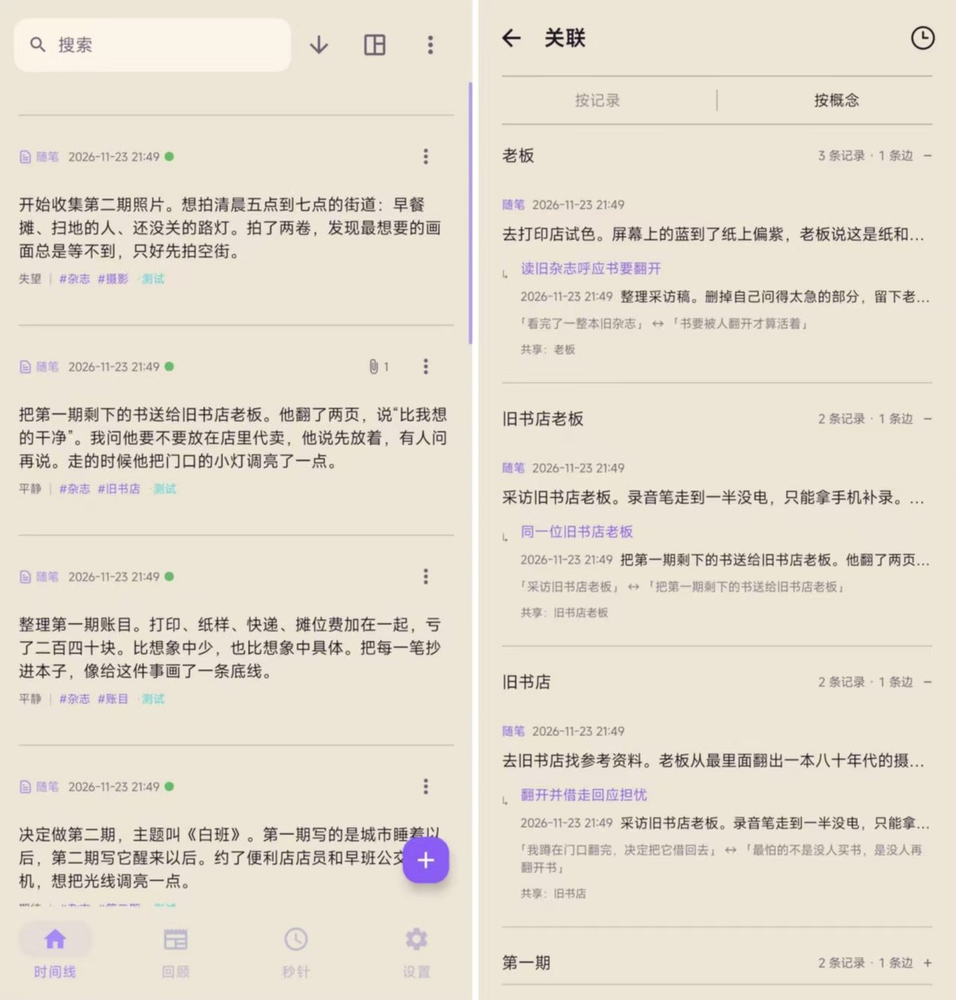
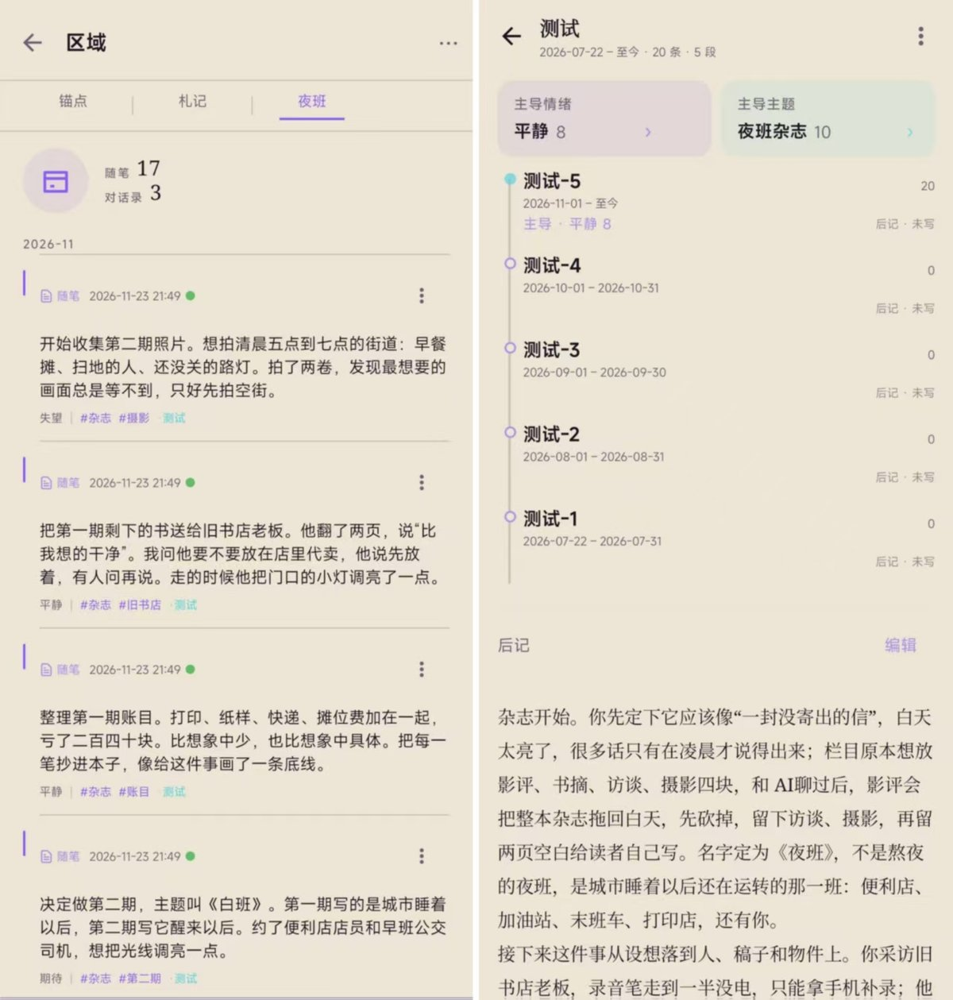
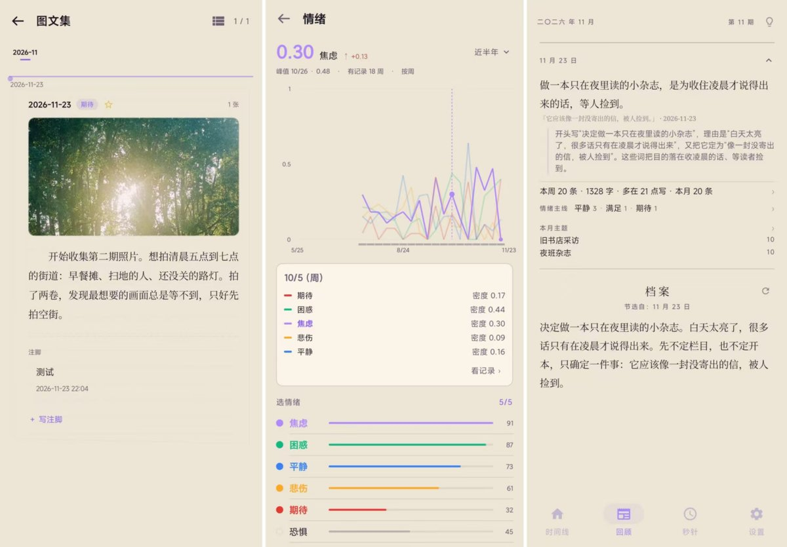
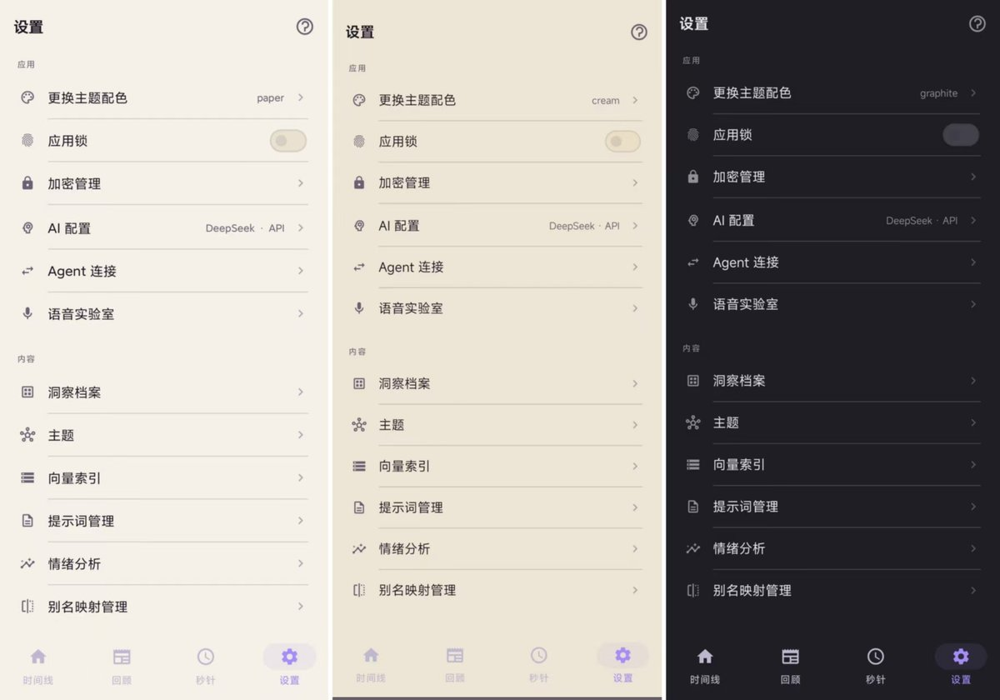

# Mirror

纯本地、无账号的个人记忆工具。记录、检索、回顾、洞察都在手机上完成；AI 能力需要你自己配置端点。

> 当前版本：1.3.0（versionCode 5）  
> 平台：Android 8.0+，arm64-v8a  
> 数据：只存在本机，没有云端副本

---

## 它是什么

- 记录按时间线保存，原文不可改写，补充内容走「增修」；
- 回顾页把本周/本月的数据、情绪、主题和旧档案放在一屏；
- 秒针把时间切成可命名的「刻度」，再用「表盘」框住一段时期；
- AI 可以给记录做分析、生成洞察、参与主题命名；
- 全部数据在本地，备份靠导出，不依赖任何账号或服务。

不适合：多端同步、协作、云端备份、社交分享。

<p align="center"></p>
<p align="center"><sub>时间线与关联 · 截图为测试数据</sub></p>

---

## 术语

| 术语 | 一句话说明 |
|---|---|
| 时间线 | 所有记录按时间倒序排列的主界面 |
| 回顾 | 本周/本月的数据、情绪主线、本月主题、近一月洞察、档案节选 |
| 秒针 | 把时间切成「刻度」，再把刻度框进「表盘」 |
| 刻度 | 一段有名字的时期，记录按创建时间归进去 |
| 表盘 | 自己圈出的一段时期，里面装若干刻度；只管框，不参与记录归属 |
| 切片 | 刻度终结时冻结的一份快照，之后不再随时间重算 |
| 锚点 | 置顶标记，用来固定重要记录 |
| 区域 | 手动型的记录集合；新建/编辑记录时可以直接选 |
| 协议 | 和标签平行的分类，导出时可以按协议挑内容 |
| 来源 | 这条记录是谁生产的；来源决定它在关联、叙事、统计里的分量 |
| 洞察 | AI 对一条、一批或近一月记录给出的判断，带原文引文，可保存成档案 |
| 关联 | AI 在分析时顺带给出的、记录之间的有向边，带一句「为什么相关」 |
| 增修 | 挂在已有记录下面的一段补充，不修改原文 |
| AI 札记 | 由 agent 写入的记录，界面上没有新建入口 |
| 图文集 | 只收集带图片附件的记录，单页翻阅 |
| 草稿 | 写东西的暂存区，不进时间线、不参与统计 |

---

## 快速开始

### 安装

1. 从 GitHub Releases 下载 `Mirror-*.apk`；
2. 在手机上允许“安装未知来源应用”，安装；
3. 首次启动按引导走，或直接跳过；
4. 设置 → AI 配置，填入端点 / 模型 / API Key（不配也能用基础功能）。

> 公开包只包含 `arm64-v8a`，x86 模拟器装不上。

### 最少需要做的事

- 用时间线右下角 `+` 写第一条记录；
- 设置 → 导出记忆包，做一次整体备份；
- 需要 AI 时再配端点，不需要就保持关闭。

---

## 功能

### 时间线

所有记录按时间排列的主界面。

- 新建：随笔 / 对话录 / 草稿；
- 搜索：全文检索 + 语义检索（本地向量）；
- 筛选：标签 / 协议 / 时间范围 / 附件 / 锁定状态；
- 顶栏：队列、排序、视图（图文集 / 区域）、更多；
- 卡片菜单：标签、协议、来源、区域、锚点、语音、洞察等。

### Agent 连接（实验）

手机是 agent 可查询、可操作的数据源；agent 反过来作为 App 的助手，帮你检索、整理和提出写入。电脑上的客户端通过局域网 HTTP 访问手机，读是实时的，写操作要在手机上批准。

**状态：实验性功能，默认关闭，不保证稳定。**

- 入口：设置 → Agent 连接；
- 服务端口：`8790`；
- 鉴权：请求头 `X-Memore-Token`，令牌在 App 内生成、可重置；
- 只读能力：记录、检索、统计、洞察、锚点、关联、刻度/表盘等；
- 写入能力：分为三档
  - 一级：免批直接执行（如新建记录、打标签、建关联）；
  - 二级：进入待批队列，必须在手机上批准；
  - 三级：直接拒绝（如加密迁移）；
- 写入以「动作」为单位提交，一次最多 20 步 / 50 条记录；
- 已执行的动作用手机端撤销（能否撤销取决于动作类型）。

配套的电脑端插件是 `memore-bridge`（DSH 插件），负责连接手机、把工具暴露给 agent；插件与本仓库分开维护。

> 安全：只在自己信任的局域网/组网里开，不要把 8790 暴露到公网；令牌等于库的读写权限，不要截图或提交进仓库。

### 秒针

把时间切成可以命名的「刻度」，再用「表盘」框住若干刻度。

- 刻度有起止、名称、状态（进行中 / 已定格）；
- 刻度页分记录 / 情绪 / 总结；
- 总结是用户写给这一段的长文，不改变起止、不触发重新定格；
- 回看由 AI 生成，独立保存，与总结分开显示；长按可删除；
- 终结刻度会冻结一份切片，之后不再随时间重算。

<p align="center"></p>
<p align="center"><sub>区域与表盘 · 没有记录的刻度也会显示</sub></p>

### 主题与线索

- 主题按月聚类，由 AI 结合记录与概念命名；
- 线索把跨月的主题对齐成稳定的几条线；
- 主题命名和线索结果会缓存；换机导入整体备份时会一并带回。

### 情绪

- 情绪分布：次数 / 频率 / 强度 / 时间四种排序；
- 情绪走势：主情绪、点选时间桶、查看该桶内各情绪的密度；
- 情绪来自 AI 分析，不是手动打的标签。

### 图文集

- 只收集带图片附件的记录；
- 单页浏览 / 列表浏览；
- 主图可切换、可放大；注脚可增删改。

### 回顾

- 本周条数 / 字数 / 常写时间 / 本月条数；
- 情绪主线；
- 本月主题；
- 近一月洞察（默认折叠，点日期展开）；
- 档案节选：从旧记录里每天挑一条。

<p align="center"></p>
<p align="center"><sub>图文集 / 情绪 / 回顾 · 近一月洞察默认折叠</sub></p>

### 洞察

- 三种读法：单条 / 选中一批 / 近一月；
- 四个视角：隐忧、动机、在意、反证；
- 每条按「结论 → 原文引文 → 依据」排列；
- 引文必须能在原文中找到，找不到会被丢弃；
- 保存后进入 设置 → 洞察档案。

### 草稿

- 起草、半成品、跑题的内容放这里，不进时间线；
- 写完整理成记录：长按草稿块 → 转录；
- 草稿不参与搜索、情绪、统计。

### 导出与导入

- 导出是唯一的安全网；
- 普通导出：JSON 或 JSON + 附件 ZIP，可选择范围/协议/刻度/标签/区域/来源；
- 整体备份：额外包含草稿、回收站、历史版本、图文集状态、设置、提示词、AI 记录、洞察档案、主题/线索缓存；
- 导入先预览再确认，重复记录跳过，失败整体回滚；
- 锁定记录默认不导出；API 密钥默认不导出；
- 整体备份不脱敏，请妥善保管。

### 加密

- 应用锁：4 位 PIN + 密保；
- 记录加密：门闩式，正文本身是明文，密码只控制界面遮蔽；
- 两者独立，可以只开一个；
- 忘记密码只能用密保重置；密保也忘了，锁定记录无法恢复。

### 主题

paper / cream / graphite 三套常用配色，同一套布局和语义色（共六套）。

<p align="center"></p>
<p align="center"><sub>paper / cream / graphite · 截图为测试数据</sub></p>

---

## 数据与隐私

- 没有账号、没有云同步、没有遥测；
- 记录、附件、向量、洞察都在本机；
- 使用 API 模式时，被分析的正文会发送到你配置的服务商；
- AI 功能使用你自行配置的第三方模型；本项目不附带对话模型，也不代表任何模型厂商；
- 导出包是明文/可读格式，分享前请自行脱敏；
- 仓库不包含任何用户数据。

---

## 构建

### 环境

- JDK 17
- Android SDK 35（compileSdk / targetSdk 35，minSdk 26）
- Android Studio 或命令行 Gradle 均可

### Debug

```bash
./gradlew :app:assembleDebug
```

产物：`app/build/outputs/apk/debug/app-debug.apk`。

### Release

仓库不包含签名文件。自己构建 release 时，需要：

1. 准备一个 keystore，放到 `.signing/public.keystore`（路径在 `app/build.gradle.kts` 里）；
2. 设置环境变量 `MEMORE_KEYSTORE_PASS`；
3. 执行：

```bash
./gradlew :app:assembleRelease
```

产物：`app/build/outputs/apk/release/app-release.apk`。

> `.signing/`、keystore、密码都已在 `.gitignore` 中，不要提交。

### 测试

```bash
./gradlew :app:testDebugUnitTest
```

### 说明

- 仓库不附带提示音；需要声音时自行放入 `app/src/debug/assets/sounds/`（debug 构建使用）；
- 公开 release 包不包含音频资源；
- ONNX Runtime 只带 `arm64-v8a`，因此没有 x86 构建；
- 依赖版本见 `app/build.gradle.kts` 与项目根 `build.gradle.kts`。

---

## 项目结构

```
app/src/main/java/memore/app/
  core/ai/          提示词、协议、AI 客户端
  data/             模型、Room、仓库、向量、导出
  service/          Agent 服务、后台任务
  ui/               Compose 页面、组件、主题
  utils/            导出/导入、声音、加密辅助
app/src/main/assets/  教程、模型
app/src/test/         单元测试
```

更细的页面与设计约定见仓库内文档与代码注释。

---

## 已知限制

- 没有云同步和自动更新；
- AI 功能依赖外部端点，格式不稳时会失败，不自动重试；
- 公开包仅 arm64，Android 8.0 以下不支持；
- Agent 连接是实验功能，协议和行为可能变；
- 部分界面在超大系统字体下仍在适配；
- 个人项目，精力有限，issue 响应不保证及时。

---

## 参与

- Bug、建议：欢迎开 issue；请写清复现步骤、Android 版本、机型；
- 想改代码：先开 issue 说明问题和方案，再提 PR；
- 不接受纯格式化 / 大规模重写类 PR；
- 个人项目，不保证响应时间。

---

## 许可证

MIT License。见仓库根目录 `LICENSE`。
